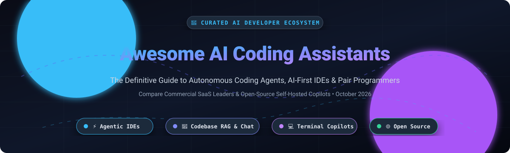

# Awesome-AI-Coding-Assistants 🤖💻

  

  
  
  
  
  
  
  

> 🌟 A curated directory of the best **AI coding assistants**, **agentic IDEs**, **codebase-aware copilots**, and **open-source developer productivity tools** for modern software engineers.

*Focused on IDE AI Assistants, Codebase-Aware Chat, Autocomplete, Autonomous Coding Agents & Developer Productivity.* 🚀

**📅 Last updated: October 2026**

---

This repository tracks notable **SaaS platforms** and **open-source projects** in the AI developer tools space. These tools operate inside your code editor, IDE, or terminal, understand entire codebases through semantic indexing and RAG, and automate code completions, refactoring, context-aware debugging, and multi-file agentic tasks. 💡

---

## 📑 Table of Contents

- [📊 Sector Overview & Market Dynamics](#-sector-overview--market-dynamics)
- [☁️ Top SaaS & Hosted AI Coding Assistants](#️-top-saas--hosted-ai-coding-assistants)
- [🔓 Open-Source GitHub Projects](#-open-source-github-projects)
- [🎯 How to Choose an AI Coding Assistant](#-how-to-choose-an-ai-coding-assistant)
- [🤝 How to Contribute](#-how-to-contribute)
- [☕ Support](#-support)
- [📈 Star History](#-star-history)
- [🛡️ Disclaimer & Data Privacy](#️-disclaimer--data-privacy)

---

## 📊 Sector Overview & Market Dynamics

The global AI code assistant and developer tools market has grown rapidly from **$3.0B–$4.6B in 2025** to an estimated **$7.1B–$9.4B in 2026** (growing at a ~25–30% CAGR), transitioning from basic autocomplete extensions into mission-critical enterprise engineering infrastructure. 📈

The sector exhibits a **hybrid market structure**: foundation model intelligence and distribution are concentrated among hyperscaler platforms and frontier labs (Microsoft/GitHub, Amazon AWS, OpenAI, Anthropic, Google), while the application and developer experience layer remains **highly fragmented and dynamic**, with agile agentic IDEs, terminal companions, and specialized context engines continuously challenging incumbent market share. ⚡

---

## ☁️ Top SaaS & Hosted AI Coding Assistants

The table below summarizes leading commercial AI coding assistants, sorted by parent company market capitalization or valuation (descending). 🏢

| Tool | Company & Valuation / Size | Starting Pricing | Free Tier / Trial Limits | Key Capabilities |
| :--- | :--- | :--- | :--- | :--- |
| **[Amazon Q Developer](https://aws.amazon.com/q/developer/)** | Amazon (Market Cap: ~$2.1T) 🏢 | **$19/user/month** (Pro Tier) | **Free Forever**: 50 agentic requests/month, 1,000 lines code transformation/month, inline completions, security scans (AWS Builder ID). | AWS-native coding assistant, deep cloud architecture support, enterprise IAM integration, and code transformations. |
| **[GitHub Copilot](https://github.com/features/copilot)** | Microsoft / GitHub (Parent Cap: ~$3.1T) 🏢 | **$10/month** (Copilot Pro) / **$19/user/month** (Business) / **$39/user/month** (Enterprise) | **Free Forever**: 2,000 code completions/month and 50 chat messages/month with basic agent workflows. | Industry benchmark assistant with editor extensions, CLI integration, GitHub ecosystem PR and issue automations. |
| **[Cursor](https://cursor.com/)** | Anysphere (Valuation: ~$29.3B; SpaceX acquisition) 🚀 | **$20/month** (Pro Tier) | **Free Forever (Hobby)**: 2,000 completions/month, limited slow/standard agent requests; includes 14-day Pro trial with frontier models. | AI-first VS Code fork with deep codebase indexing, multi-file edits, Cursor Composer, and agentic workflows. |
| **[JetBrains AI Assistant](https://www.jetbrains.com/ai/)** | JetBrains (Valuation: ~$7B est., ~$260M ARR) 🦄 | **$10/month** (AI Pro) / **$30/month** (AI Ultimate) | **30-day Free Trial** for AI Pro; **AI Free Tier**: unlimited local code completion/local model support, plus limited cloud credits. | Deep IDE-native integration for IntelliJ, PyCharm, WebStorm, and the JetBrains suite with Junie agent capabilities. |
| **[Windsurf](https://codeium.com/windsurf)** | Codeium / Windsurf (Valuation: ~$1.25B–$2.85B) 🏄 | **$15/month** (Pro Tier) | **Free Forever**: Unlimited inline completions, 25 daily Cascade agent / premium chat credits, multi-IDE support. | Next-gen agentic IDE powered by the Cascade engine, enabling real-time collaborative human-AI coding and deep flow states. |
| **[Codeium](https://codeium.com/)** | Codeium (Valuation: ~$1.25B–$2.85B) ⚡ | **$15/month** (Pro Tier) | **Free Forever**: Unlimited single-line and multi-line code completions across 70+ languages and 40+ IDEs, with standard in-editor chat. | High-speed, privacy-first autocomplete and codebase search supporting VS Code, JetBrains, Vim, Neovim, and Eclipse. |
| **[Sourcegraph Cody](https://sourcegraph.com/cody)** | Sourcegraph (Valuation: ~$2.6B, ~$40M ARR) 🔍 | **$16,000/year** (Enterprise Platform minimum) | **30-day Enterprise Trial**; individual access offered through cloud credit allowances and open snapshots. | Enterprise-scale code intelligence and repository-wide context engine capable of navigating massive multi-repo codebases. |
| **[Augment Code](https://www.augmentcode.com/)** | Augment Inc. (Valuation: ~$977M post-money) 🚀 | **$20/month** (Developer Tier) | **14-day Free Trial**: Full access to the repository context engine and workspace indexing (requires sign-up verification). | Context-engine focused AI assistant optimized for large monorepos, multi-file software refactors, and complex code architectures. |
| **[Tabnine Enterprise](https://www.tabnine.com/)** | Tricentis / Tabnine (Acquired 2026; $56M–$102M funding raised) 🛡️ | **$12/user/month** (Dev Tier) / **$39/user/month** (Enterprise) | **14-day Free Trial**: Full enterprise feature trial with private model deployments and team policies (no permanent free tier). | Security- and compliance-oriented coding platform with support for air-gapped VPCs, custom fine-tuned models, and zero data retention. |
| **[Supermaven](https://supermaven.com/)** | Anysphere / Cursor (Acquired Nov 2024; standalone sunset) ⚡ | **$10/month** (Legacy Pro; now part of Cursor) | **Free Tier (Legacy)**: Free high-speed autocomplete; absorbed into **Cursor Tab** (Hobby plan includes 2,000 completions). | Pioneer of ultra-low latency completion and 1-million-token context windows, now powering Cursor Tab core infrastructure. |

---

## 🔓 Open-Source GitHub Projects

Open-source AI coding assistants offer complete transparency, self-hosting capabilities, local LLM execution (via Ollama, vLLM, or LM Studio), and zero vendor lock-in. 🛠️

*Sorted by GitHub Stars_Count (descending):*

| Project | GitHub_Stars | Description |
| :--- | :--- | :--- |
| **[Open WebUI](https://github.com/open-webui/open-webui)** |  | Extensible, self-hosted AI interface with native code execution, artifact previews, and multi-model local/remote LLM support. 🌐 |
| **[OpenHands](https://github.com/All-Hands-AI/OpenHands)** |  | Autonomous software development agent platform (formerly OpenDevin) capable of modifying code, executing shell commands, and resolving GitHub issues end-to-end. 🙌 |
| **[Cline](https://github.com/cline/cline)** |  | Autonomous coding agent extension for VS Code that executes terminal commands, reads browser pages, and edits project files with human-in-the-loop approvals. 🤖 |
| **[Open Interpreter](https://github.com/openinterpreter/openinterpreter)** |  | Terminal and natural-language computer interface that executes code locally in Python, JavaScript, Shell, and more to automate complex developer workflows. 💻 |
| **[GPT Engineer](https://github.com/AntonOsika/gpt-engineer)** |  | CLI tool that builds entire codebases from a single natural language prompt, generating project scaffolds, source files, and test suites automatically. 🏗️ |
| **[Aider](https://github.com/Aider-AI/aider)** |  | Terminal pair programming tool that inspects Git repositories, edits multi-file codebases, writes tests, and automatically formats Git commits. 🧑‍💻 |
| **[LibreChat](https://github.com/LibreChat-AI/LibreChat)** |  | Enhanced open-source AI platform supporting multiple providers, codebase RAG, file attachments, and code artifact rendering. 💬 |
| **[Continue](https://github.com/continuedev/continue)** |  | Modular open-source AI coding assistant extension for VS Code and JetBrains, supporting local models (Ollama) and custom enterprise context providers. ⏩ |
| **[Tabby](https://github.com/TabbyML/tabby)** |  | Self-hosted, private AI coding assistant server providing real-time autocomplete and chat without external cloud API dependencies. 🐱 |
| **[FauxPilot](https://github.com/fauxpilot/fauxpilot)** |  | Self-hosted alternative to GitHub Copilot using NVIDIA Triton and open code generation models for completely on-premise autocompletion. ✈️ |
| **[PR-Agent](https://github.com/The-PR-Agent/pr-agent)** |  | Autonomous pull request review agent that provides automated code feedback, security audits, changelog summaries, and PR improvements. 🔍 |
| **[Sweep](https://github.com/sweepai/sweep)** |  | AI junior developer agent that turns bug reports and feature tickets directly into tested pull requests on GitHub. 🧹 |
| **[Cody (Sourcegraph Core)](https://github.com/sourcegraph/cody-public-snapshot)** |  | Sourcegraph's open snapshot repository for Cody's VS Code extension, multi-repository context retriever, and semantic search client. 🔎 |

---

## 🎯 How to Choose an AI Coding Assistant

1. **For Agentic Editing & Multi-File Tasks:** Tools like **Cursor**, **Windsurf**, **Cline**, and **OpenHands** excel at understanding cross-file dependencies and running shell commands. 🤖
2. **For Terminal & Git Workflows:** **Aider** is the premier choice for terminal pair programming with automated git commit generation. 💻
3. **For Enterprise Security & Air-Gapped Environments:** **Tabnine**, **Amazon Q Developer**, and self-hosted **Tabby** / **Continue** ensure strict data isolation and IP protection. 🛡️
4. **For Free & Open-Source Enthusiasts:** **Continue** paired with local **Ollama** or **vLLM** provides a 100% private, cost-free coding setup. 🚀

---

## 🤝 How to Contribute

Contributions to expand and update this list are warmly welcomed! 🎉

1. 🍴 Fork this repository.
2. 📝 Add or update entries in `README.md` maintaining table formatting, pricing accuracy, free tier limitations, and stargazers badges.
3. 🏷️ Ensure tools are categorized correctly (SaaS vs. Open Source).
4. 🚀 Submit a Pull Request with a clear description of the updates made.

---

## ☕ Support

If you found this curated list helpful, please consider showing your support:

- ⭐ **Star** this repository to help others discover it.
- 🍴 **Fork** and contribute new tools or updates.
- 📢 **Share** it with your fellow engineers, teammates, and communities!
- ☕ **Buy me a coffee / Sponsor**: If you'd like to support ongoing maintenance and new curated resources, you can sponsor the project via the **[GitHub Sponsors Dashboard](https://github.com/sponsors/ishandutta2007)**.

Thank you so much for your generosity and encouragement! ❤️

---

## 📈 Star History

---

## 🛡️ Disclaimer & Data Privacy

- ℹ️ This is a community-curated directory intended for educational and evaluation purposes.
- 🔒 Commercial coding assistants may transmit telemetry and code snippets to cloud models. Always consult your organization's security policies and data processing agreements (DPAs) before using cloud-hosted assistants on proprietary codebases.

---

  <b><a href="#awesome-ai-coding-assistants-">⬆️ Back to Top</a></b>

